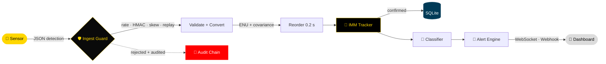
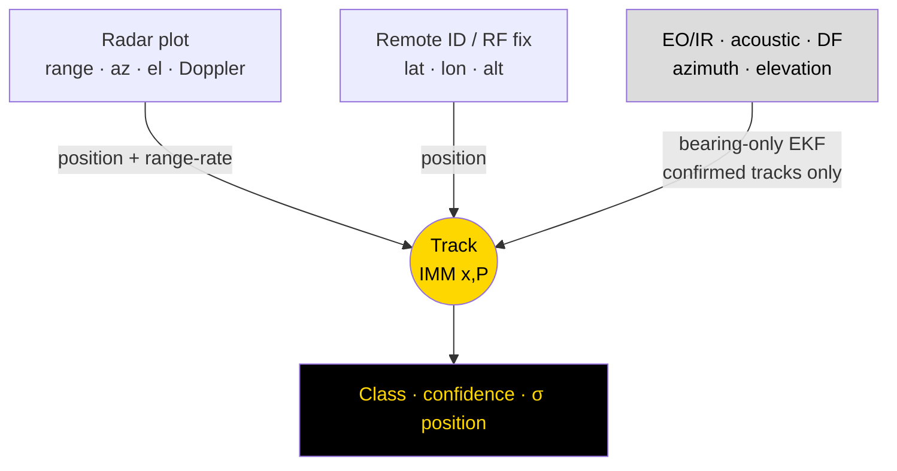
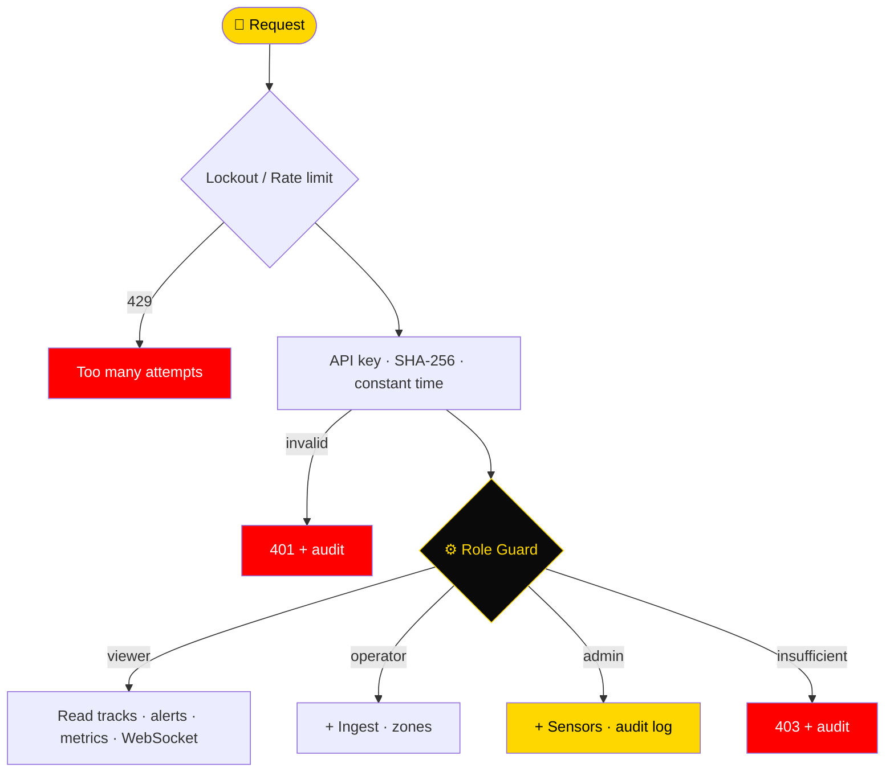
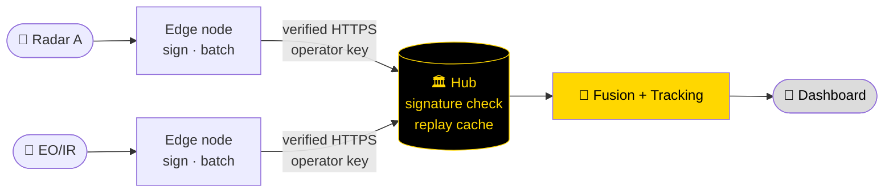

<div align="center">


[](https://git.io/typing-svg)

<br/>

<p align="center">
  
  
  
  
  
</p>

<p align="center">
  
  
  
  
  
  
  
  
  
</p>

<p align="center">
  <a href="https://github.com/NietoDeveloper/sdt-drone-radar">
    
  </a>
  <a href="docs/API.md">
    
  </a>
  <a href="docs/SECURITY.md">
    
  </a>
</p>

<br/>

> **Software DT Ecosystem:** *The detection, tracking and evidence engine behind our Digital Twin air-space
> awareness stack.*

> 🛰️ **Drone Radar DT.** A production-minded **Python backend** that receives plots from radars and other
> sensors, fuses them into stable **tracks** (ID · 3-D position · velocity · heading · RCS · class · confidence ·
> trajectory · source sensors), tells **drones from birds** with micro-Doppler, raises **zone alerts**, **records**
> everything in a tamper-evident way, and streams it in real time to any dashboard through a **REST + WebSocket**
> API — hardened with roles, signed ingest and an audit chain.
>
> *Modular · Measured · Obsessively Honest About Its Limits · Built in Bogotá 🇨🇴*

</div>

---

## 🆕 Latest Platform Updates — v2.0

<div align="center">


</div>

| Update | Description | Measured impact (simulator) |
|:-------|:------------|:----------------------------|
| 🧮 **IMM Motion Model** | A quiet and a manoeuvre constant-velocity model, blended by how well each explains the data, with exact per-second switching | Horizontal RMSE **10.2 → 7.7 m**; never-matched false tracks **1.1 → 0.25** per 150 s |
| 📡 **Doppler-Aided Updates** | Radar radial velocity enters the filter as a gated range-rate measurement | Velocity estimates sharpen (tested ≥ 20 % lower RMSE); bad Doppler is gated out |
| 🎥 **Bearing-Only Fusion** | EO/IR, acoustic and RF direction finders feed azimuth/elevation (no range) into the same tracker | With one EO/IR array: **5.5 m horizontal / 5.7 m vertical** RMSE (was 10.2 / 12.7), ID switches **1.4** per run |
| 🔐 **Roles + Lockout + Tickets** | Hashed API keys (viewer < operator < admin), rate limits, brute-force lockout, single-use WebSocket tickets | Verified live: forbidden / locked-out / ticket-reuse all refused |
| ✍️ **Signed Ingest** | Per-sensor HMAC-SHA256, clock-skew window, replay cache, fail-closed secrets | Verified live: unsigned, forged and replayed detections rejected and audited |
| 📜 **Audit Chain** | Every security event hashed into the previous one; `audit-verify` finds the first tampered line | Edit / delete / reorder all detected in tests |
| 📊 **Prometheus + JSON Logs** | `/metrics`, request-id correlated structured logs, automatic retention | Scrape-ready out of the box |
| 🔔 **Signed Webhooks** | Alert delivery with retry/back-off and a bounded queue — never blocks tracking | Tested against a live HTTP receiver |
| 🛰️ **Edge Forwarder** | `sdt-radar forward`: collect locally, sign, batch, ship over verified HTTPS, survive outages | Verified live: edge node → TLS hub → tracks |

---

## 🏗️ System Architecture

```
╔══════════════════════════════════════════════════════════════════════════════╗
║                           DRONE RADAR DT ECOSYSTEM                           ║
╠══════════════════════════════════════════════════════════════════════════════╣
║                                                                              ║
║  ┌────────────────────────────────────┐   ┌─────────────────────────────┐    ║
║  │  SENSORS                           │   │  EDGE NODES                 │    ║
║  │  FMCW · Pulse-Doppler · AESA       │──►│  sdt-radar forward          │    ║
║  │  RF · Remote ID · EO/IR · Acoustic │   │  sign · batch · verified TLS│    ║
║  └──────────────┬─────────────────────┘   └───────────────┬─────────────┘    ║
║                 │ UDP / TCP (JSON)                        │ HTTPS            ║
║                 ▼                                         ▼                  ║
║  ┌──────────────────────────────────────────────────────────────────────┐    ║
║  │ INGEST GUARD  parse → rate limit → HMAC → clock skew → replay → schema│   ║
║  ├──────────────────────────────────────────────────────────────────────┤    ║
║  │ FUSION   polar | angular | geodetic → ENU + covariance → reorder 0.2 s│   ║
║  ├──────────────────────────────────────────────────────────────────────┤    ║
║  │ TRACKER  IMM · Doppler · bearing-only EKF · Hungarian GNN · lifecycle │   ║
║  ├──────────────────────────────────────────────────────────────────────┤    ║
║  │ CLASSIFY micro-Doppler dwell → STFT → logistic → per-track evidence   │   ║
║  ├──────────────────────────────────────────────────────────────────────┤    ║
║  │ ALERTS   zones (circle/polygon + altitude) · intrusion · approach     │   ║
║  └───────┬─────────────────┬─────────────────┬──────────────────┬────────┘   ║
║          ▼                 ▼                 ▼                  ▼            ║
║   ┌─────────────┐   ┌─────────────┐   ┌─────────────┐   ┌──────────────┐     ║
║   │ SQLite WAL  │   │ REST  /api  │   │ WebSocket   │   │ Webhooks ·   │     ║
║   │ tracks·pts  │   │ RBAC · rate │   │ tickets ·   │   │ Prometheus · │     ║
║   │ alerts·zones│   │ limits      │   │ 5 Hz        │   │ Audit chain  │     ║
║   └─────────────┘   └──────┬──────┘   └──────┬──────┘   └──────────────┘     ║
╚═══════════════════════════╪═══════════════════╪════════════════════════════╝
                            ▼                   ▼
              Any dashboard · other Software DT backends
```

---

## 📂 Repository Structure

```text
sdt-drone-radar/                    ← Python repository root
│
├── 🐍 src/sdt_radar/
│   ├── models.py  config.py  geo.py  pipeline.py  runtime.py  cli.py  bench.py
│   ├── 🛡️ security/        ← API keys + roles · rate limit + lockout · HMAC signing · WS tickets · audit chain
│   ├── 📥 ingest/          ← UDP + TCP servers · JSONL recorder · deterministic replay
│   ├── 🔀 fusion/          ← polar / angular / geodetic → ENU+covariance · reorder buffer
│   ├── 🎯 tracking/        ← Kalman/EKF primitives · measurement physics · IMM · multi-target tracker
│   ├── 🦅 classification/  ← micro-Doppler synthesis · features · logistic model (packaged)
│   ├── 🚨 alerts/          ← zones · intrusion / approach state machine · risk score
│   ├── 🗄️ storage/         ← Store protocol · memory · SQLite (writer thread)
│   ├── 🌐 api/             ← FastAPI (RBAC) · ASGI guards · WebSocket hub · Prometheus
│   ├── 🔔 notify.py        ← signed webhooks
│   ├── 🛰️ forwarder.py     ← edge-node collector / forwarder
│   ├── 📡 radar/           ← range equation · sensor catalogue
│   └── 🧪 sim/             ← targets · sensor models · scenarios · scoring
│
├── 📖 docs/                ← ARCHITECTURE · SECURITY · API · SENSOR_INTEGRATION · CLASSIFICATION
│                             OPERATIONS · RADAR_PRIMER · ROADMAP · timescale_schema.sql
├── ⚙️ config/default.toml  ← fully commented example configuration
├── ✅ tests/               ← 104 tests: tracking · security · API · WebSocket · UDP/TCP · scenarios
├── 🐳 Dockerfile
├── 🧾 CHANGELOG.md
└── 📖 README.md
```

---

## 🛠️ Unified Technology Stack

<div align="center">

| Layer | Technologies | Engineering Focus |
|:------|:-------------|:------------------|
| 🎯 **Tracking** | NumPy (vectorised `einsum`) · SciPy Hungarian | IMM · EKF (position, bearing, Doppler) · GNN association · 500 tracks |
| 🦅 **Classification** | SciPy STFT · NumPy inference · L-BFGS training | Micro-Doppler features · per-track evidence accumulation |
| 🌐 **API** | FastAPI · Pydantic v2 · Uvicorn | Strict validation · OpenAPI · REST + WebSocket |
| 🔐 **Security** | `hashlib` · `hmac` · `secrets` (stdlib only) | Roles · lockout · signed ingest · audit chain — no crypto dependencies |
| 🗄️ **Storage** | SQLite (WAL) · JSONL | Writer thread · raw audit log · deterministic replay |
| 📊 **Observability** | Prometheus text format · JSON logs | Request ids · latency quantiles · sensor health |
| 🔔 **Delivery** | Signed webhooks · asyncio · threads | Bounded queues · retry/back-off · drop-oldest |
| 🧪 **Quality** | pytest · mypy · ruff | Scenario scoring against ground truth |
| 🐳 **DevOps** | Docker · GitHub Actions | Non-root image · lint + type + test matrix |

</div>

---

## ✨ Core Features & Technical Flow

### 🔄 Detection → Track Pipeline



### 🧮 Multi-Sensor Fusion Flow



### 🔐 Security & Role-Based Access Control



### 🛰️ Distributed Edge Network



---

## 🖥️ Real-Time Operations Panel (API)

> Live operational picture for any frontend — snapshots at **5 Hz**, alerts pushed instantly, **no polling**.

<div align="center">

| Module | Capability | Endpoint | Role |
|:-------|:-----------|:---------|:----:|
| 🎯 **Live Tracks** | Active tracks with class, confidence, σ, sensors | `GET /api/v1/tracks` | viewer |
| 🗺️ **Trajectories** | Stored history per track; archive of past tracks | `GET /api/v1/tracks/{id}/history` | viewer |
| ⚡ **Live Stream** | Snapshots + alert events, per-client filters | `WS /ws/v1/stream` (ticket) | viewer |
| 🚨 **Alerts** | Open and historical intrusion / approach alerts | `GET /api/v1/alerts` | viewer |
| 🛡️ **Zones** | Circle / polygon + altitude band, persisted | `POST/DELETE /api/v1/zones` | operator |
| 📥 **HTTP Ingest** | Batch detections (≤ 5 000) | `POST /api/v1/ingest/detections` | operator |
| 📡 **Sensors** | Registry, health, `signed` status | `GET/POST /api/v1/sensors` | viewer / admin |
| 📜 **Audit** | Hash-chained security events + head hash | `GET /api/v1/audit` | admin |
| 📊 **Metrics** | JSON + Prometheus exposition | `/api/v1/metrics` · `/metrics` | viewer |

</div>

Full contract (fields, status codes, WebSocket messages, wire formats): **[docs/API.md](docs/API.md)**.

### 📦 What a track contains

| Field | Meaning |
|:------|:--------|
| `track_id` · `seq` | Unique ID and per-run sequence number |
| `status` | `tentative` → `confirmed` → `coasting` (→ `lost` in the archive) |
| `lat` `lon` `alt_m` · `east_m` `north_m` `up_m` | WGS-84 position and local ENU position |
| `vel_*` · `speed_mps` · `heading_deg` · `climb_mps` | Velocity, course over ground (0° = North, clockwise) |
| `target_class` · `class_confidence` | `drone` / `bird` / `clutter` / `unknown` and its posterior |
| `confidence` | Heuristic existence score 0–1 — **not** a calibrated probability |
| `position_sigma_m` · `rcs_dbsm` | Filter uncertainty and smoothed RCS |
| `sensors` · `first_seen` · `last_seen` · `age_s` · `hits` | Provenance and lifetime |

---

## 🐍 Python Infrastructure Guide

> **Zero heavy dependencies.** Five libraries (`numpy`, `scipy`, `pydantic`, `fastapi`, `uvicorn`). All security
> primitives are the standard library.

### Prerequisites

Python **3.11+**. Docker is optional (a non-root image is provided; it was not built in the authoring environment).

### ⚡ Quick Start — 3 Steps to the Full Ecosystem

**Step 1 — Clone and install**

```bash
git clone https://github.com/NietoDeveloper/sdt-drone-radar.git
cd sdt-drone-radar
python -m venv .venv && source .venv/bin/activate
pip install -e ".[dev]"
pytest -q          # 104 tests
```

**Step 2 — Create keys and configure**

```bash
sdt-radar keygen --role admin  --id ops        # prints the token ONCE + the hash to store
sdt-radar keygen --role viewer --id dashboard
cp config/default.toml radar.toml              # paste the printed [[api.keys]] records into radar.toml
```

```toml
# radar.toml  (secrets never live here: only hashes; signing secrets come from the environment)
[[api.keys]]
id = "dashboard"
role = "viewer"
sha256 = "<hash printed by keygen>"

[[sensors]]
id = "fmcw-1"
kind = "radar_fmcw"
lat = 4.7110
lon = -74.0721
hmac_secret_env = "SDT_FMCW1_SECRET"     # this sensor MUST sign every detection
```

**Step 3 — Launch**

```bash
export SDT_FMCW1_SECRET='…'
sdt-radar serve --config radar.toml                       # loopback: UDP 9100 · TCP 9101 · API 8080
sdt-radar serve --config radar.toml --host 0.0.0.0 \
     --tls-cert cert.pem --tls-key key.pem                # public: needs keys (refused otherwise)
```

```
🤖 What the service does automatically:
   ├── Validates every detection and counts what it rejects
   ├── Verifies HMAC signature · clock skew · replay for signed sensors
   ├── Fuses radar / RF / Remote ID / EO-IR into one track picture
   ├── Records confirmed tracks + a hash-chained audit trail
   └── Streams snapshots (5 Hz) and alerts to every dashboard

   🛰️  Ingest   →  udp://127.0.0.1:9100  ·  tcp://127.0.0.1:9101
   🌐  API      →  http://127.0.0.1:8080   (OpenAPI at /docs)
```

### 🎬 See It Work in 2 Minutes (no hardware)

```bash
# terminal 1
SDT_RADAR_API_KEY=demo sdt-radar serve --config config/default.toml

# terminal 2 — registers the scenario's sensors + zone, then streams a simulated perimeter attack
sdt-radar sim --scenario perimeter --seed 1 --duration 60 \
              --udp 127.0.0.1:9100 --api http://127.0.0.1:8080 --api-key demo
```

```bash
curl -s -H 'x-api-key: demo' 'localhost:8080/api/v1/tracks?target_class=drone' | python -m json.tool | head -40
curl -s -H 'x-api-key: demo' 'localhost:8080/api/v1/alerts?active=true'
```

```python
# live stream from a browser-style client: ticket first, then WebSocket
import asyncio, json, urllib.request, websockets
req = urllib.request.Request("http://127.0.0.1:8080/api/v1/auth/ws-ticket", method="POST", headers={"x-api-key": "demo"})
ticket = json.load(urllib.request.urlopen(req))["ticket"]

async def main():
    async with websockets.connect(f"ws://127.0.0.1:8080/ws/v1/stream?ticket={ticket}") as ws:
        await ws.send(json.dumps({"subscribe": {"classes": ["drone"], "min_confidence": 0.5}}))
        async for raw in ws:
            msg = json.loads(raw)
            if msg["type"] == "snapshot": print(msg["count"], "drone tracks")
            elif msg["type"] == "alert":  print("ALERT", msg["alert"]["level"], msg["alert"]["message"])
asyncio.run(main())
```

### 🛰️ Edge Node → Hub (distributed sensors)

```bash
export OPKEY='sdtr_edge7_…'  S_FMCW1='…'
sdt-radar forward --hub https://radar-hub:8443 --cafile private-ca.pem \
                  --api-key-env OPKEY --sign fmcw-1=S_FMCW1 --listen-udp 9100
```

### 🛑 Operations & Maintenance

```bash
sdt-radar audit-verify data/audit.jsonl          # exit 1 + first bad line if the chain was tampered with
sdt-radar replay raw.jsonl --config radar.toml   # deterministic replay of a recording (tuning, regression)
sdt-radar score --scenario perimeter --seed 1    # tracking metrics against simulated ground truth
sdt-radar bench --targets 500                    # scale benchmark
sdt-radar budget --power-w 10 --gain-dbi 35 --bandwidth-mhz 5 --integration-db 30   # size a radar
sdt-radar catalog                                # sensor-type reference
sdt-radar train-classifier                       # retrain the packaged synthetic micro-Doppler model
ruff check src tests && mypy src && pytest -q    # the full quality gate
```

---

## 🎨 Dashboard Design Tokens

> Suggested tokens so a Software DT frontend renders this backend's data consistently — industrial,
> dark-first, gold-accented. The backend does not enforce them.

```javascript
/** Suggested mapping — Software DT palette applied to radar semantics */
export const radarTokens = {
  targetClass: {
    drone:   "#FFD700",   // 🟡 gold — primary brand accent: the thing you must see
    unknown: "#FEB60D",   // 🟠 needs attention until classified
    bird:    "#DCDCDC",   // 🩶 gainsboro — de-emphasised, low risk
    clutter: "#8A8A8A",
  },
  alertLevel: { critical: "#FF0000", warning: "#FEB60D", info: "#DCDCDC" },
  surface: { base: "#DCDCDC", card: "#FFFFFF", dark: "#111111", text: "#000000" },
  trackStatus: { confirmed: "solid", coasting: "dashed", tentative: "hidden by default" },
  uncertainty: "circle of radius position_sigma_m",
};
```

| Token | Hex | Role |
|:------|:----|:-----|
| `drone` | `#FFD700` | Drone tracks · primary highlights |
| `unknown` / `warning` | `#FEB60D` | Unclassified tracks · warning alerts |
| `bird` / `info` | `#DCDCDC` | Birds · informational |
| `critical` | `#FF0000` | Intrusion alerts |
| `dark` | `#111111` | Dark map surfaces and panels |

---

## 🚀 Deployment

```
┌───────────────────────────────────────────────────────────────┐
│                     RECOMMENDED TOPOLOGY                       │
│                                                                │
│  Sensors ──► Edge node (sign + batch) ──HTTPS──┐               │
│                                                ▼               │
│  Sensors ──UDP/TCP (signed, firewalled)──►  🏛️ Hub             │
│                                          reverse proxy (TLS)   │
│                                          sdt-radar serve       │
│                                          SQLite · audit chain  │
│                                                │               │
│        Prometheus ◄── /metrics        Dashboards ◄── WSS       │
│        Webhook receivers ◄── signed alerts                     │
└───────────────────────────────────────────────────────────────┘
```

| Environment | Ingest | API |
|:------------|:-------|:----|
| **Development** | `udp://127.0.0.1:9100` | `http://127.0.0.1:8080` (open on loopback) |
| **Production** | Firewalled UDP/TCP with signatures, or HTTPS from edge nodes | HTTPS behind a proxy (or `--tls-cert`), keys required |

---

## 📊 Requirements vs. Measured Results

All figures come from this repository's **physics-based simulator** and test suite — evidence that the software
meets the targets, **not** proof about any radar. Whether a *sensor* detects a 0.01 m² target at 2–5 km is a
hardware property (use `sdt-radar budget` and a vendor datasheet).

<div align="center">

| Requirement | v1 baseline | **v2 measured** |
|:------------|:-----------:|:---------------:|
| Track-level detection rate ≥ 90 % | ≥ 99 % | **≥ 99 %** (8 seeds); **99 %** with 500 targets |
| Horizontal / vertical position error | 10.2 / 12.7 m | **7.7 / 11.0 m** · **5.5 / 5.7 m** with EO/IR |
| Never-matched false tracks per 150 s | 1.1 (worst 3) | **0.25** (worst 1) · 0.9 (worst 2) with EO/IR |
| ID switches per 150 s (21 targets) | 2.9 | 4.5 (worst 11) · **1.4** (worst 4) with EO/IR |
| 100–500 simultaneous tracks | 500 · p50 73 ms | **500 · p50 112 ms · p99 184 ms** per 2 s scan (4.1× real time) |
| 500-target ID switches | 83 | **43** |
| Display latency < 500 ms | p99 249 ms ingest→tracked | unchanged pipeline timing; suite asserts p99 < 500 ms |
| Drone ↔ bird confusions | 0 (8 seeds) | **0** (8 seeds) |

</div>

Honest reading: without EO/IR the v2 tracker has **more** ID switches than v1 on these seeds (4.5 vs 2.9) —
the price of the more agile IMM and of requiring 5 confirmations; it buys better accuracy and far fewer false
tracks, and EO/IR bearings more than recover the continuity. The classifier numbers (91 % per dwell; drone 97 %,
bird 94 %, clutter 81 %) are unchanged and come from **synthetic** signatures.

**Verified live (real sockets, one run):** self-signed TLS hub with HSTS and no `Server` header · data from 4 signed
sensors forwarded by an edge node over verified HTTPS (2 381 detections, **0 rejected**) ·
21 tracks (6 drones / 15 birds) fused from 4 sensors · viewer `POST` → **403**, no key → **401**, viewer on the
audit log → **403** · an unsigned detection, a forged signature and a replayed signature → **all rejected and
counted** · 6 wrong keys → **lockout (429), even for a valid key** · WSS via one-time ticket **accepted once, refused
on reuse** · audit chain **verified** (14 records; `audit-verify` exit 0).

---

## ✅ Quality Evidence

* **104 automated tests, 0 failures**; `ruff check` and `mypy` clean on 53 source files.
* Tracking: Kalman consistency (NIS), batch/scalar equivalence, finite-difference checks of the bearing and Doppler
  Jacobians, IMM invariants (no transition at `dt = 0`, per-second switching), manoeuvre following, gated bad
  Doppler, bearing-only refinement that can neither start nor confirm tracks, two-sensor fusion gain, duplicate merging.
* Security: key hashing/roles, token bucket, lockout, signatures (order, tamper, NaN), replay, skew, fail-closed
  secrets, ticket single-use, audit edit/delete/reorder/restart, RBAC matrix over every endpoint, hardening
  headers, body limit, Host allow-list, secrets never in API output.
* Integration: REST, WebSocket, UDP/TCP with latency budget, webhook signature/retry/overflow, forwarder
  batching/signing/outage/auth-error behaviour, retention task, Prometheus output, CLI and configuration validation.
* Scenarios: perimeter and 200/500-target swarm scored against ground truth.

---

## ⚠️ Known Limitations of v2

Stated plainly so nobody mistakes a verified baseline for a fielded system:

* **Validated on a simulator only.** No real radar, RF or Remote ID receiver was used; sensor models are
  planning-grade (Swerling-I detection, range-scaled noise).
* **The classifier is trained on synthetic micro-Doppler** (X band, PRF 10–16 kHz); retrain and validate on
  recorded data per band. Clutter is its weakest class.
* **No vendor adapters, no SAPIENT/ASTERIX bridge, no passive-radar / RF / acoustic signal processing** — those
  sensors enter as detections (polar, angular or geodetic).
* **Security is defence in depth, not certification:** no mTLS, OIDC, user accounts or encryption at rest;
  rate-limit/lockout state is per-process memory; keys need a restart to rotate; **unsigned UDP/TCP ingest is
  spoofable** (signatures are opt-in); no third-party penetration test. See [docs/SECURITY.md](docs/SECURITY.md) §8.
* **Storage:** SQLite only; TimescaleDB is a schema reference (`docs/timescale_schema.sql`), untested.
* **Tracking:** constant-velocity IMM (no coordinated-turn model); bearing-only data refines but cannot start
  tracks; hard manoeuvres can still fragment tracks; GNN, not JPDA/MHT.
* **Single process**, one core of tracking (500 targets ≈ 6 % of a core at 2 s scans); no horizontal scaling yet.
* **The frontend is not included.** The Docker image and CI workflow are provided but were not executed here.

The prioritised fix list is in [docs/ROADMAP.md](docs/ROADMAP.md).

---

## 🔗 Links & Resources

<div align="center">

| Resource | Link |
|:---------|:-----|
| 📂 **GitHub Repository** | [github.com/NietoDeveloper/sdt-drone-radar](https://github.com/NietoDeveloper/sdt-drone-radar) |
| 👤 **Developer Profile** | [github.com/NietoDeveloper](https://github.com/NietoDeveloper) |
| 🏛️ **Architecture** | [docs/ARCHITECTURE.md](docs/ARCHITECTURE.md) |
| 🔐 **Security Model** | [docs/SECURITY.md](docs/SECURITY.md) |
| 📡 **API Contract** | [docs/API.md](docs/API.md) |
| 🔌 **Sensor Integration** | [docs/SENSOR_INTEGRATION.md](docs/SENSOR_INTEGRATION.md) |
| 🦅 **Classification** | [docs/CLASSIFICATION.md](docs/CLASSIFICATION.md) |
| 🛠️ **Operations** | [docs/OPERATIONS.md](docs/OPERATIONS.md) |
| 📚 **Radar Primer** | [docs/RADAR_PRIMER.md](docs/RADAR_PRIMER.md) |
| 🗺️ **Roadmap** · 🧾 **Changelog** | [docs/ROADMAP.md](docs/ROADMAP.md) · [CHANGELOG.md](CHANGELOG.md) |

</div>

---

<div align="center">

[](https://github.com/NietoDeveloper/sdt-drone-radar)
[](https://github.com/NietoDeveloper)
[](docs/SECURITY.md)

<br/>

```
╔══════════════════════════════════════════════════════════════════╗
║                                                                  ║
║   "Every claim in this repository is measured, and every         ║
║    limitation is written next to the claim it qualifies."        ║
║                                                                  ║
║                               — NietoDeveloper Standard          ║
╚══════════════════════════════════════════════════════════════════╝
```

*Drone Radar DT — Built by **NietoDeveloper · Manuel Nieto***

*Developed with technical rigor in* 📍 **Bogotá, Colombia** 🇨🇴

*Proprietary — © SoftwareDT.com. All rights reserved.*

<br/>


</div>
